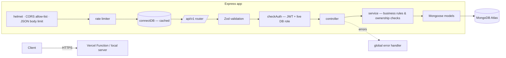
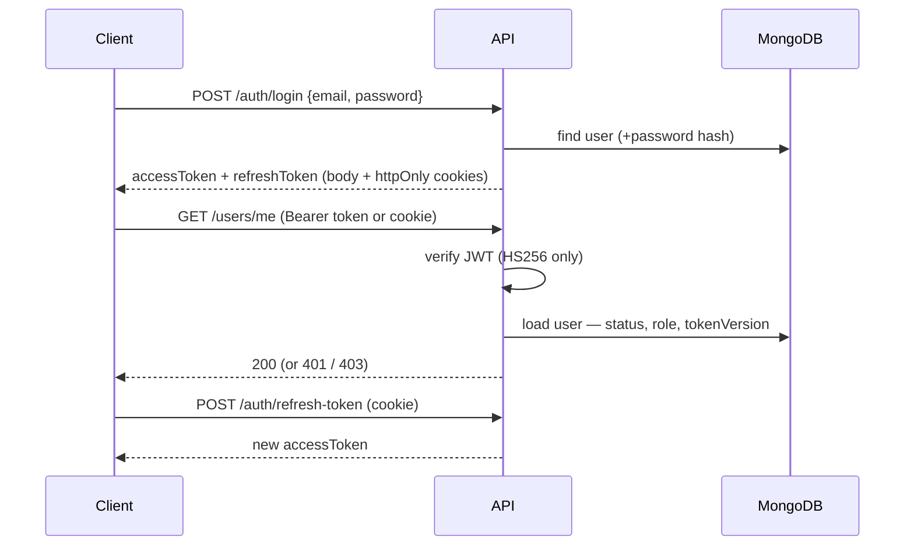

# QuickHire — Job Portal REST API

A RESTful backend for a job marketplace where **job seekers** build profiles and apply to jobs, **employers** run company accounts with team roles and post listings, and **platform admins** moderate companies, categories and featured jobs.

Built with **TypeScript, Express 5, MongoDB (Mongoose 8) and Zod 4**, with a focus on correct authorization, input validation, and a test suite that exercises the real HTTP API.

> **Project type:** personal learning and portfolio project, not a commercial production system.
> **Deployment status:** prepared for Vercel's free (Hobby) tier — not yet deployed.
> **Live API:** _not yet deployed — add the URL here after the first deployment._

|                         |                                                                                                |
| ----------------------- | ---------------------------------------------------------------------------------------------- |
| **Language / runtime**  | TypeScript 5 (strict) on Node.js ≥ 20                                                          |
| **Framework**           | Express 5                                                                                      |
| **Database**            | MongoDB (Mongoose 8), MongoDB Atlas free cluster recommended                                   |
| **Auth**                | JWT access + refresh tokens (httpOnly cookies or `Bearer` header), Google OAuth 2.0 (optional) |
| **Validation**          | Zod 4 at every request boundary                                                                |
| **Security middleware** | Helmet, CORS allow-list, express-rate-limit, body-size limits                                  |
| **Testing**             | Vitest + Supertest against an in-memory MongoDB replica set — 102 tests                        |
| **Hosting target**      | Vercel Functions (zero-config Express)                                                         |

---

## Contents

1. [What it does](#what-it-does)
2. [Architecture](#architecture)
3. [Project structure](#project-structure)
4. [Getting started](#getting-started)
5. [Environment variables](#environment-variables)
6. [Scripts](#scripts)
7. [Testing](#testing)
8. [API overview](#api-overview)
9. [Authentication and authorization](#authentication-and-authorization)
10. [Security measures](#security-measures)
11. [Deploying to Vercel](#deploying-to-vercel)
12. [Known limitations](#known-limitations)
13. [Engineering notes](#engineering-notes)
14. [Further documentation](#further-documentation)

---

## What it does

**Job seekers**

- Register with email + password or Google, then build a profile (headline, bio, skills, languages, expected salary, availability, social links) with an automatically computed **profile-completeness score**.
- Add education and work-experience entries.
- Keep up to 5 resumes (title + file URL) with one default.
- Apply to published jobs, track applications, and withdraw them.

**Employers**

- Create one company per account, with a slug-based public page once an admin verifies it.
- Build a team with company roles — `OWNER`, `ADMIN`, `HR`, `RECRUITER`, `INTERVIEWER` — and role-based rules for who can add, promote or remove whom.
- Post job listings with a `draft → published → closed / expired` lifecycle, salary ranges, skills and locations.
- Review applicants (status, private note, 0–100 score) for jobs of companies they manage.

**Admins**

- Manage a two-level job-category hierarchy (tree, breadcrumbs, cached job counts).
- Verify or reject companies, feature job listings, and browse users with filters and pagination.

**Public**

- Full-text job search (weighted text index: title > skills > description) with filters for category, type, work mode, experience, location and salary, plus sorting and pagination.

---

## Architecture

A layered **route → middleware → controller → service → model** design, one folder per domain module.



- **`src/app.ts`** builds the Express app and default-exports it. Vercel runs this export as a single serverless function; locally, `src/server.ts` imports the same app and calls `listen()`.
- **Database connections** are created lazily and cached per process (`src/app/config/db.ts`), which suits serverless instances that are reused across requests.
- **Authorization happens in two layers:** coarse platform roles in `checkAuth(...roles)`, and fine-grained ownership / company-role checks inside services (e.g. "is this user an active `HR` member of the company that owns this job?").
- **Errors** from Zod, Mongoose, MongoDB, JWT and body parsing are mapped to one JSON shape by a single error handler.

More detail: [docs/ARCHITECTURE.md](docs/ARCHITECTURE.md).

---

## Project structure

```text
QuickHire/
├── src/
│   ├── app.ts                 # Express app (security middleware, routes, error handling) — Vercel entry
│   ├── server.ts              # Local/long-running entry: connect DB, listen, graceful shutdown
│   └── app/
│       ├── builder/           # Generic QueryBuilder (search, filter, range, sort, paginate)
│       ├── config/            # env validation, DB connection, Passport strategies
│       ├── middlewares/       # checkAuth, validateRequest, rateLimiter, error + 404 handlers
│       ├── helpers/           # Error translators (Zod, cast, duplicate key, validation)
│       ├── modules/           # One folder per domain:
│       │   ├── auth/  user/
│       │   ├── company/  companyMember/
│       │   ├── jobCategory/  jobListing/  Application/
│       │   └── seekerProfile/  seekerEducation/  seekerExperience/  resume/
│       ├── routes/index.ts    # Mounts every module router under /api/v1
│       ├── shared/            # Shared schemas, validation helpers, QueryBuilder types
│       └── utils/             # JWT, cookies, response helper, catchAsync, …
├── tests/                     # Vitest + Supertest API tests (in-memory MongoDB)
├── scripts/generate-module.ts # CLI scaffolder for new modules
├── docs/                      # Architecture, API, security, deployment, testing, …
└── AGENTS.md                  # Instructions for AI coding assistants
```

Each module contains `*.route.ts`, `*.controller.ts`, `*.service.ts`, `*.models.ts`, `*.interface.ts`, `*.validation.ts` and, where needed, `*.constants.ts` / `*.utils.ts`.

---

## Getting started

**Prerequisites:** Node.js 20+ (22 LTS recommended), npm, and a MongoDB **replica set** — a free MongoDB Atlas cluster works out of the box. (Company creation and some deletes use transactions, which a standalone `mongod` does not support.)

```bash
git clone https://github.com/Humayun1318/QuickHire.git
cd QuickHire
npm install
cp .env.example .env        # then fill in DB_URL, secrets, admin credentials
npm run dev                 # http://localhost:5000
```

On the first request (or at startup with `npm run dev`) the API connects to MongoDB and creates the **super admin** from `SUPER_ADMIN_EMAIL` / `SUPER_ADMIN_PASSWORD` if it does not exist.

Quick check:

```bash
curl http://localhost:5000/                      # health check
curl "http://localhost:5000/api/v1/jobs?limit=5" # public job search
```

---

## Environment variables

Defined and validated in [`src/app/config/env.ts`](src/app/config/env.ts); the app refuses to start if a required value is missing or malformed. A template lives in [`.env.example`](.env.example).

| Variable                                                            | Required | Description                                    |
| ------------------------------------------------------------------- | -------- | ---------------------------------------------- |
| `NODE_ENV`                                                          | yes      | `development`, `production` or `test`          |
| `PORT`                                                              | no       | Local port (default `5000`; ignored on Vercel) |
| `DB_URL`                                                            | yes      | MongoDB connection string (replica set)        |
| `FRONTEND_URL`                                                      | yes      | Main frontend origin — CORS + OAuth redirects  |
| `CORS_ORIGINS`                                                      | no       | Extra allowed origins, comma-separated         |
| `BCRYPT_SALT_ROUND`                                                 | yes      | bcrypt cost, integer 8–14                      |
| `JWT_ACCESS_SECRET` / `JWT_REFRESH_SECRET`                          | yes      | Long random strings; must differ in production |
| `JWT_ACCESS_EXPIRES` / `JWT_REFRESH_EXPIRES`                        | yes      | e.g. `15m` / `7d`                              |
| `SUPER_ADMIN_EMAIL` / `SUPER_ADMIN_PASSWORD`                        | yes      | Seeded super-admin account                     |
| `TRUST_PROXY`                                                       | no       | Proxy hops to trust; auto `1` on Vercel        |
| `GOOGLE_CLIENT_ID` / `GOOGLE_CLIENT_SECRET` / `GOOGLE_CALLBACK_URL` | no       | Enable Google sign-in (all three)              |

---

## Scripts

| Command                           | Purpose                                                 |
| --------------------------------- | ------------------------------------------------------- |
| `npm run dev`                     | Development server with reload (`ts-node-dev`)          |
| `npm run build`                   | Compile `src/` to `dist/`                               |
| `npm start`                       | Run the compiled server (`dist/server.js`)              |
| `npm test`                        | Run the test suite once                                 |
| `npm run test:watch`              | Tests in watch mode                                     |
| `npm run typecheck`               | Type-check src, tests and scripts                       |
| `npm run lint` / `lint:fix`       | ESLint (+ Prettier rules)                               |
| `npm run format` / `format:check` | Prettier                                                |
| `npm run check`                   | typecheck + lint + test + build — run before committing |
| `npm run generateModule`          | Scaffold a new module folder                            |

---

## Testing

```bash
npm test
```

The suite boots the real Express app with **Supertest** and a throw-away **in-memory MongoDB replica set** (`mongodb-memory-server`), so no external database or credentials are needed. The first run downloads a MongoDB binary (several hundred MB), and later runs reuse it.

**Current result:** 6 test files, **102 tests passing**. They cover:

- registration and login, including blocked privilege escalation, mass-assignment and NoSQL-operator payloads
- JWT handling: `Bearer` / bare / cookie tokens, expired, forged and `alg: none` tokens, authorization from the live DB role, token invalidation after a password change
- cross-tenant access (IDOR): employers editing other companies' jobs, reading other companies' applicants, or seekers modifying others' records
- job search, sorting, filters and regex escaping, the job lifecycle, and consistency of category counters
- applications: duplicates, draft/expired jobs, review rules, and withdrawal counters
- app-level behaviour: Helmet headers, CORS allow-list and preflight, malformed JSON, the 413 body limit, the 404 shape

See [docs/TESTING.md](docs/TESTING.md).

---

## API overview

Base path: **`/api/v1`**. Success responses look like this:

```json
{ "statusCode": 200, "success": true, "message": "…", "data": {}, "meta": {} }
```

Errors look like this:

```json
{
  "success": false,
  "message": "…",
  "errorSources": [{ "path": "email", "message": "Invalid email format" }]
}
```

| Area            | Key endpoints                                                                                                                                                                          |
| --------------- | -------------------------------------------------------------------------------------------------------------------------------------------------------------------------------------- |
| Auth            | `POST /auth/register`, `POST /auth/login`, `POST /auth/refresh-token`, `POST /auth/logout`, `POST /auth/change-password`, `GET /auth/google`                                           |
| Users           | `GET /users/me`, `GET /users` (admin, paginated), `GET /users/:id` (admin)                                                                                                             |
| Jobs            | `GET /jobs` (public search), `GET /jobs/:id`, `GET /jobs/slug/:slug`, `GET /jobs/company/:companyId`, `POST/PATCH/DELETE /jobs…`, `PATCH /jobs/:id/status`, `PATCH /jobs/:id/featured` |
| Categories      | `GET /job-categories/tree`, `/roots`, `/slug/:slug`, `/:id/children`; admin CRUD                                                                                                       |
| Companies       | `POST /companies`, `GET /companies/me`, `GET /companies?slug=`, `PATCH/DELETE /companies/:id`, `PATCH /companies/:id/verification`                                                     |
| Company members | `POST/GET /companies/members`, `PATCH /companies/members/:memberId`, `DELETE …/:companyId/:memberId`, `DELETE …/leave/:companyId`                                                      |
| Seekers         | `/seeker-profiles`, `/seeker-educations`, `/seeker-experiences`                                                                                                                        |
| Resumes         | `/resumes` CRUD + `PATCH /resumes/:id/set-default`                                                                                                                                     |
| Applications    | `POST /applications`, `GET /applications/my-applications`, `PATCH …/:id/withdraw`, `GET /applications/jobs/:jobId`, `PATCH …/:id/review`                                               |

Full reference with payloads, roles and error codes: [docs/API.md](docs/API.md).

---

## Authentication and authorization



- **Platform roles:** `super_admin`, `admin`, `seeker`, `employer`. Self-registration allows `seeker` or `employer` only. The super admin is seeded from environment variables.
- **The current database role is authoritative.** Roles embedded in tokens are not trusted, so suspensions and role changes apply on the next request.
- **Changing the password logs out every other session.** Each token carries a `tokenVersion` that is bumped on password change.
- **Company roles** (`OWNER` / `ADMIN` / `HR` / `RECRUITER` / `INTERVIEWER`) gate member management, job posting and applicant review. The owning company is always derived from the resource itself, never from a client-supplied id.
- **Google OAuth** (optional) uses a state nonce bound to an httpOnly cookie (prevents login CSRF), accepts only verified Google emails, and redirects to relative frontend paths only.

---

## Security measures

Implemented (details and limitations in [docs/SECURITY.md](docs/SECURITY.md)):

- Helmet security headers, `x-powered-by` disabled
- CORS allow-list with credentials; browser requests from other origins are rejected with 403
- Rate limiting: 300 requests / 15 min per IP on the API, 20 / 15 min on auth endpoints
- 100 kb JSON body limit; length limits on strings and arrays
- Zod validation on every body and query, with unknown fields stripped (no mass assignment) and ObjectIds validated
- bcrypt password hashing (cost 8–14, enforced), passwords limited to bcrypt's 72-byte input
- JWTs pinned to HS256, tokens invalidated on password change, cookies `HttpOnly` (+ `Secure; SameSite=None` in production)
- Regex input escaped in all user-driven `$regex` queries
- URL fields restricted to `http(s)` (blocks `javascript:` stored-XSS payloads)
- No stack traces or internal error messages in production responses
- `npm audit`: 0 known vulnerabilities at the time of writing; Dependabot configured

---

## Deploying to Vercel

The app uses Vercel's **zero-configuration Express support**: Vercel detects `src/app.ts`, which default-exports the Express app, and runs it as one Vercel Function. No `vercel.json` is required.

1. Create a free **MongoDB Atlas** cluster, a database user, and allow network access from `0.0.0.0/0` (Vercel has no fixed IPs on the free plan).
2. Import the GitHub repository at [vercel.com/new](https://vercel.com/new). Framework preset: **Express** (auto-detected).
3. Add the environment variables from the table above with `NODE_ENV=production`.
4. Deploy, then smoke-test `GET /` and `GET /api/v1/jobs`.

Step-by-step guide, free-tier limits and troubleshooting: [docs/DEPLOYMENT.md](docs/DEPLOYMENT.md).

---

## Known limitations

- **Rate limits are per serverless instance** (in-memory store), not global. This is good enough for a portfolio and is documented in [docs/SECURITY.md](docs/SECURITY.md).
- **Logout clears cookies, but JWTs stay valid until they expire**, because there is no server-side token denylist. Use a short `JWT_ACCESS_EXPIRES`.
- **No file storage.** Resumes and logos are stored as URLs; uploading the files is the client's responsibility.
- **Job expiry is evaluated at query time.** Expired jobs disappear from search and reject applications, but their `status` field is not rewritten by a background job.
- No email verification, password reset, or notification flows yet.
- Google OAuth has not been exercised end-to-end in automated tests (it needs real Google credentials).

---

## Engineering notes

A few decisions worth highlighting:

- **Verify, don't assume.** The audit found subtle Mongoose pitfalls: a `required` default set in `pre('save')`, which runs _after_ validation; a guarded counter decrement where `findByIdAndUpdate` silently dropped the guard and let counts go negative; and duplicate index declarations that made index creation fail (caught by the new test suite). Each suspected issue was reproduced before it was fixed, and each is covered by a regression test.
- **Ownership comes from the data, not the request.** Job updates load the job first and authorize against _its_ `companyId` instead of a `companyId` supplied by the client. Regression tests try cross-company edits with and without a forged id.
- **Serverless-friendly by design.** No session store, a lazily cached DB connection, no background timers, and a stateless JWT design, so the same app runs under `node dist/server.js` or as a Vercel Function.
- **Backwards-compatible fixes.** The job endpoints originally required a `{ "body": { … } }` wrapper. They now accept flat JSON and still unwrap the legacy shape.

---

## Further documentation

| Document                                         | Contents                                                 |
| ------------------------------------------------ | -------------------------------------------------------- |
| [docs/ARCHITECTURE.md](docs/ARCHITECTURE.md)     | Request lifecycle, modules, data model, design decisions |
| [docs/API.md](docs/API.md)                       | Endpoint reference                                       |
| [docs/SECURITY.md](docs/SECURITY.md)             | Implemented controls, limitations, checklist             |
| [docs/DEPLOYMENT.md](docs/DEPLOYMENT.md)         | Local setup and Vercel deployment                        |
| [docs/TESTING.md](docs/TESTING.md)               | Test strategy and commands                               |
| [docs/DEVELOPMENT.md](docs/DEVELOPMENT.md)       | Workflow and conventions                                 |
| [docs/QUERY_BUILDER.md](docs/QUERY_BUILDER.md)   | QueryBuilder reference                                   |
| [docs/PROJECT_STATUS.md](docs/PROJECT_STATUS.md) | Current status and open items                            |
| [AGENTS.md](AGENTS.md)                           | Rules for AI coding assistants                           |

---

## Author

**Humayun Kabir** · [GitHub](https://github.com/Humayun1318) · [Portfolio](https://my-portfolio-brown-eta-20.vercel.app/) · humayunkabir6267@gmail.com

_No license file is included yet. All rights are reserved by the author until one is added._
