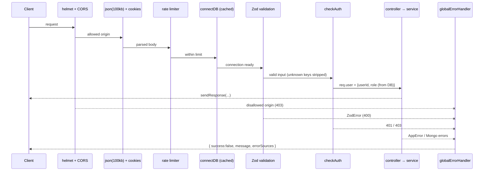
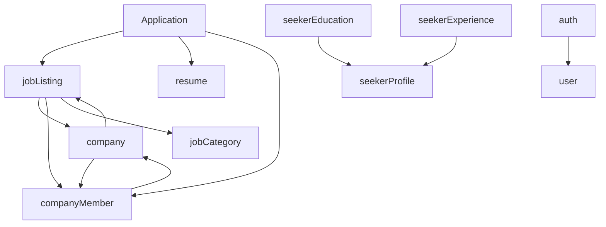
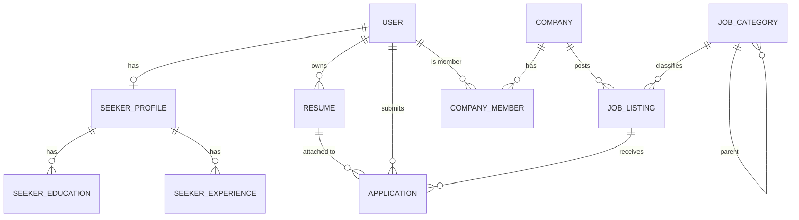

# Architecture

## Overview

QuickHire is a single Express 5 application written in TypeScript, backed by MongoDB through Mongoose. The code is organised as one folder per business domain ("module") with a strict layering inside each module.

```text
route  →  middleware (validate, auth)  →  controller  →  service  →  model  →  MongoDB
```

| Layer             | Responsibility                                                                        | Must not               |
| ----------------- | ------------------------------------------------------------------------------------- | ---------------------- |
| `*.route.ts`      | Path, HTTP method, middleware order, platform-role gate                               | Contain logic          |
| `*.validation.ts` | Zod schemas for body and query                                                        | Touch the database     |
| `*.controller.ts` | Read the request, call one service function, send the response through `sendResponse` | Contain business rules |
| `*.service.ts`    | Business rules, ownership and company-role checks, multi-step writes                  | Read `req`/`res`       |
| `*.models.ts`     | Schema, indexes, hooks, small static helpers                                          | Call other services    |

## Entry points

| File            | Used by                                 | What it does                                                                                   |
| --------------- | --------------------------------------- | ---------------------------------------------------------------------------------------------- |
| `src/app.ts`    | Vercel (default export) and `server.ts` | Builds the Express app: security middleware, DB-connect middleware, routes, 404, error handler |
| `src/server.ts` | `npm run dev`, `npm start`              | Connects to MongoDB, calls `app.listen`, handles graceful shutdown                             |

Because `app.ts` has no side effects beyond building the app, the same code runs as a long-lived server or as a Vercel Function.

## Request lifecycle



The middleware order is defined in `src/app.ts`:

1. `helmet()`, with `x-powered-by` disabled
2. `cors()`. The allow-list comes from `FRONTEND_URL` + `CORS_ORIGINS`. Requests without an `Origin` header are allowed; other origins get 403
3. `cookieParser()`, then `express.json({ limit: '100kb' })`
4. `passport.initialize()` (no sessions)
5. `GET /` health check, which needs no database
6. `/api/v1`: `apiLimiter`, then `connectDB()`, then the module routers
7. `notFound`, then `globalErrorHandler`

## Modules

| Module                                 | Collection                               | Purpose                                                                          |
| -------------------------------------- | ---------------------------------------- | -------------------------------------------------------------------------------- |
| `auth`                                 | —                                        | Register, login (passport-local), refresh, logout, change password, Google OAuth |
| `user`                                 | `users`                                  | `GET /users/me`, admin user list and lookup                                      |
| `company`                              | `companies`                              | Company profile, slug, verification, soft delete                                 |
| `companyMember`                        | `companymembers`                         | Team membership with company roles and assign/remove rules                       |
| `jobCategory`                          | `jobcategories`                          | Two-level hierarchy, tree and breadcrumb, cached `jobCount`                      |
| `jobListing`                           | `joblistings`                            | Jobs, lifecycle, public search, company dashboard listing                        |
| `Application`                          | `applications`                           | Seeker applications, employer review                                             |
| `resume`                               | `resumes`                                | Seeker resumes (URL), one default                                                |
| `seekerProfile`                        | `seekerprofiles`                         | Profile and completeness score                                                   |
| `seekerEducation` / `seekerExperience` | `seekereducations` / `seekerexperiences` | Profile sub-records                                                              |

### Dependencies between modules



Services import other modules' **models** freely, and import other **services** only for shared side effects such as counter updates or cascading deactivation. `company.service` ↔ `jobListing.service` is the only service-level cycle. It is safe because both sides use the imports only inside functions.

## Data model



Key constraints and indexes:

| Collection     | Constraint                                                                                                                    |
| -------------- | ----------------------------------------------------------------------------------------------------------------------------- |
| users          | unique `email`; index on `role`, `status`, `auths.provider + auths.providerId`                                                |
| companies      | unique `slug`; **partial unique `ownerId` where `isActive: true`** (one active company per owner)                             |
| companymembers | unique `(companyId, userId)`                                                                                                  |
| jobcategories  | unique `name`, unique `slug`                                                                                                  |
| joblistings    | unique `slug`; weighted text index `title/skills/description`; compound indexes for status/expiry, company, category, filters |
| applications   | unique `(applicantId, jobId)`                                                                                                 |
| seekerprofiles | unique `userId`                                                                                                               |

**Soft deletes.** Users have a `status` field. Companies, jobs, categories, resumes, seeker profiles and memberships use `isActive`. Every read path filters on these flags.

**Denormalised counters:**

- `JobCategory.jobCount` counts **published** jobs. It is adjusted whenever a job enters or leaves the published state, changes category while published, or is deleted, including the cascade from a company delete.
- `JobListing.applicationCount` and `viewCount`.
- `SeekerProfile.profileCompleteness`. It is recomputed from profile fields by hooks; the education and experience points are applied with `$inc` by those services.

## Authentication and authorization

- **Tokens.** HS256 JWTs carrying `{ userId, email, role, tv }`. The access token and refresh token use separate secrets. They are returned in the login response body and also set as httpOnly cookies.
- **checkAuth.** Extracts the token from `Authorization` (Bearer or bare) or the cookie, verifies it, loads the user by `userId`, rejects inactive accounts and stale `tokenVersion`s, then checks the **database** role against the allowed list.
- **tokenVersion.** Stored on the user and incremented by change-password. Tokens with an old `tv` are rejected by both `checkAuth` and refresh.
- **Company authorization.** `requireCompanyRole()` and the job service's `assertJobManager()` check active `CompanyMember` records. Job operations always derive the company from the stored job document.
- **Google OAuth.** Uses passport-google-oauth20 without sessions. A random nonce is stored in a short-lived httpOnly cookie and inside the base64url `state`; the callback rejects mismatches. Linking a Google login to an existing account requires a Google-verified email.

## Database connection

`src/app/config/db.ts` caches the `mongoose.connect` promise at module level:

- The first request on a cold instance connects with `serverSelectionTimeoutMS: 10s` and `maxPoolSize: 10`, then seeds the super admin (idempotent).
- Later requests reuse the connection. A failed connect is not cached, so the next request retries; the failed request gets a 503.

Transactions are used for company creation (company + OWNER membership) and for education/experience deletion. They require a replica set, which MongoDB Atlas provides.

## Error handling

Controllers are wrapped in `catchAsync`, and every error reaches `globalErrorHandler`, which maps:

| Error                                     | Status                                                       |
| ----------------------------------------- | ------------------------------------------------------------ |
| `AppError(status, msg)`                   | its status                                                   |
| `ZodError` / Mongoose `ValidationError`   | 400 with `errorSources`                                      |
| `CastError` (bad ObjectId)                | 400                                                          |
| Mongo `11000` duplicate key               | 409 (field name only, no value echoed)                       |
| `JsonWebTokenError` / `TokenExpiredError` | 401                                                          |
| body-parser errors                        | 400 (malformed JSON) / 413 (too large)                       |
| anything else                             | 500. Logged server-side; generic message outside development |

## Design decisions

| Decision                                             | Reason                                                                                                        |
| ---------------------------------------------------- | ------------------------------------------------------------------------------------------------------------- |
| No `express-session`                                 | Stateless JWTs work on serverless without a session store. OAuth state is protected by a nonce cookie instead |
| DB role over token role                              | Role changes and bans apply immediately, and a leaked token cannot carry a stale elevated role                |
| Derive ownership from stored documents               | Prevents IDOR via client-supplied `companyId`                                                                 |
| Partial unique index for one company per owner       | Concurrency-safe and still allows re-creation after a soft delete                                             |
| Query-time expiry filtering                          | No background worker is needed (Vercel free tier has no always-on process)                                    |
| In-memory rate limiter                               | Free and dependency-free; the per-instance limitation is documented                                           |
| Legacy `{ body: {...} }` unwrapping on job endpoints | Fixing the contract without breaking existing clients                                                         |
